# HouseView

An opinionated [Home Assistant](https://www.home-assistant.io/) dashboard that makes everyday home controls easy for
**everyone else**.

[](https://hacs.xyz/docs/faq/custom_repositories)
[](LICENSE)
[](https://github.com/dandoingdev/HouseView/actions/workflows/ci.yml)
[](https://github.com/dandoingdev/HouseView/releases/latest)

Home Assistant can do an incredible amount. The people you share your home with should be able to walk up to a screen
and use it without a tour of your setup. HouseView brings the things they need into a few clear, swipeable pages: lights,
heating, music, cameras and the kitchen timer.

It makes deliberate choices about layout, touch controls and what belongs on screen. Big buttons, familiar gestures and
room for the essentials help everyday tasks feel straightforward. Put it on a wall tablet, a kitchen display or an
NSPanel Pro, choose the controls that matter in that room, and give everyone a comfortable way to use the home.

When the screen is idle, it can become a weather display, photo frame, calendar, album cover or a clear view of the timer.

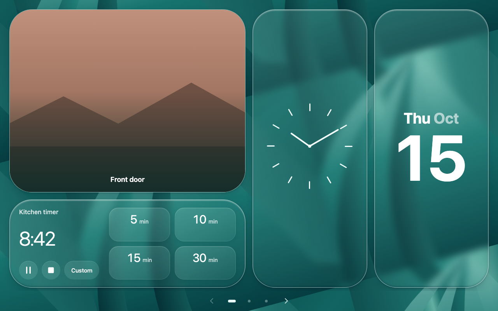

A kitchen dashboard, with music and home controls a swipe away. Try the [kitchen example](examples/kitchen.yaml):

| Music page | Home controls page |
| --- | --- |
| 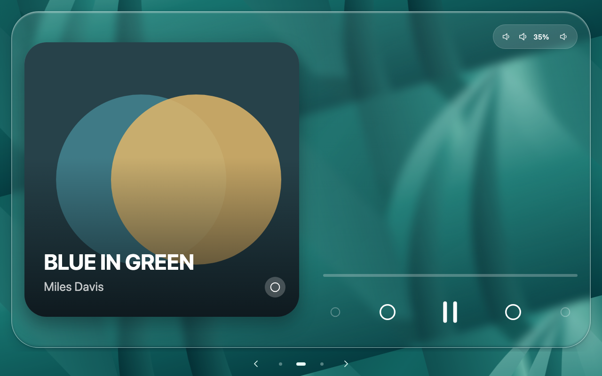 | 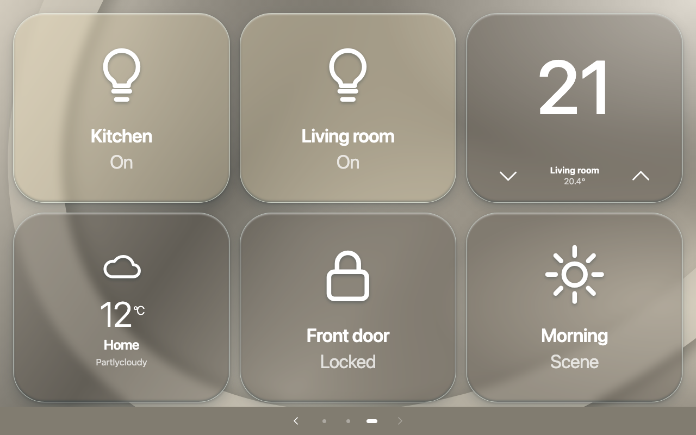 |

| Bedtime dashboard | Kitchen page on a portrait tablet |
| --- | --- |
| 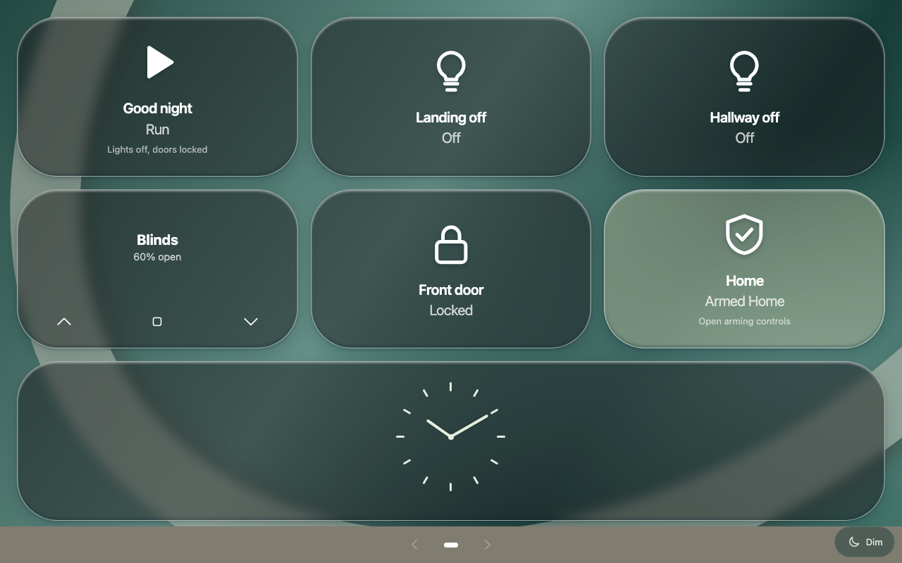 | 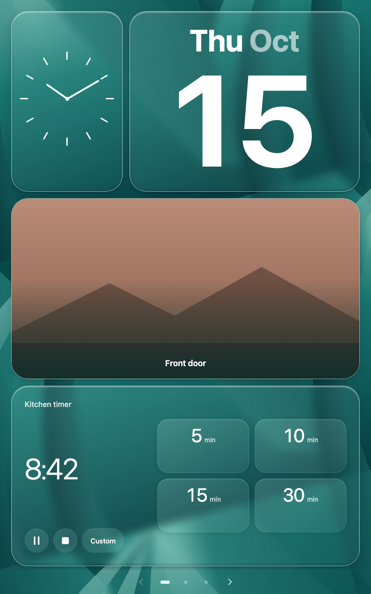 |

### NSPanel Pro

The same dashboard on a square wall panel. An NSPanel Pro 86 is a 480 × 480 touchscreen, and each page holds four
controls. Hold a light to set its brightness, press the thermostat number to set the heating, and leave it idle for the
clock. These pictures are that resolution inside a mock of the panel. Setup is in [NSPanel Pro](docs/nspanel.md), and
the dashboard is the [panel example](examples/nspanel.yaml).

| Room | Scenes | Music |
| --- | --- | --- |
| 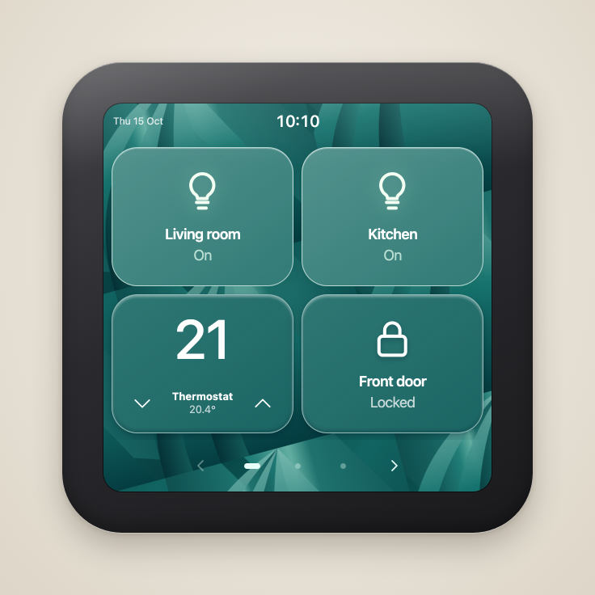 | 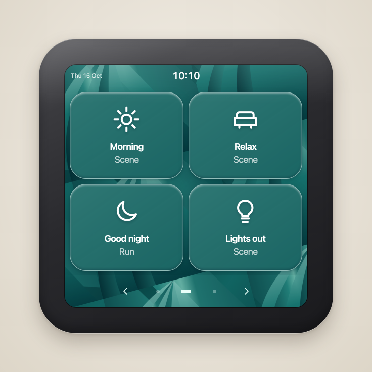 | 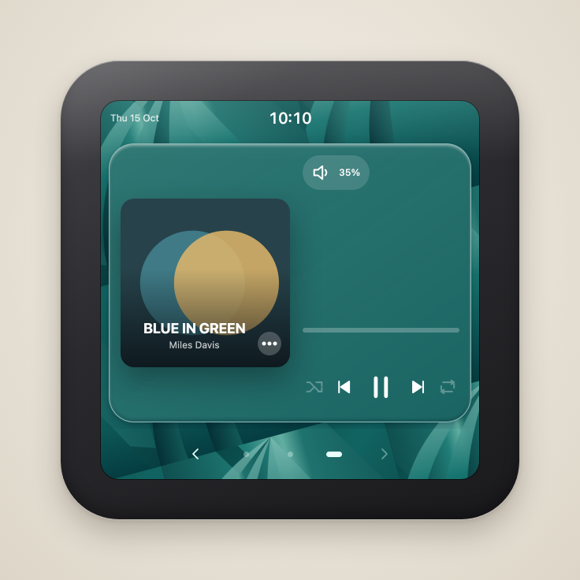 |

| Brightness | Thermostat | Clock |
| --- | --- | --- |
| 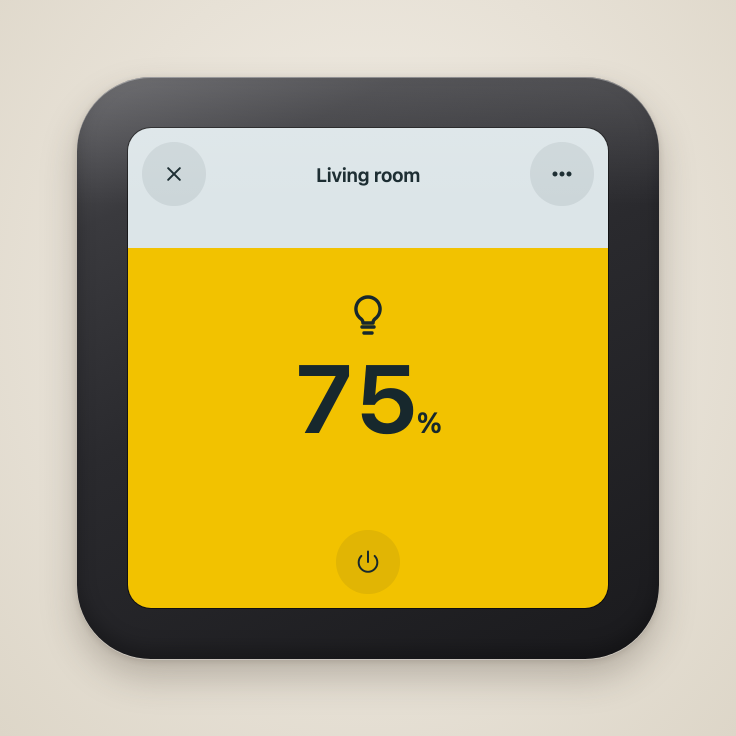 | 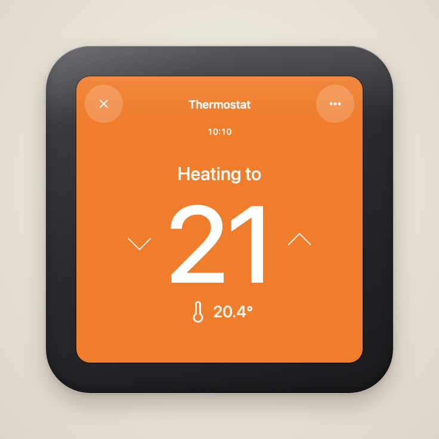 | 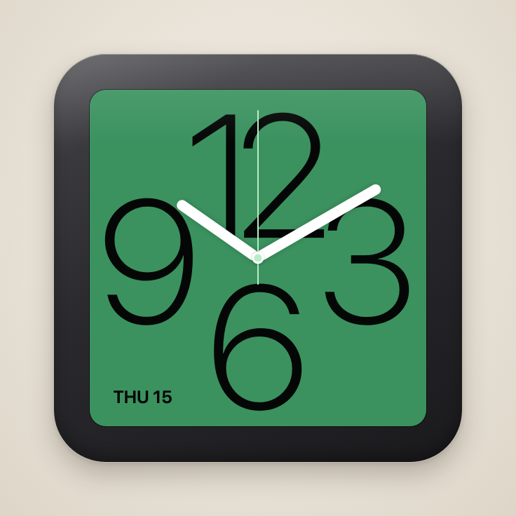 |

### Overviews

Give the whole screen to what matters right now: the weather, a running timer, your music or a favourite photo.

| Weather | Timer display | Cover art |
| --- | --- | --- |
| 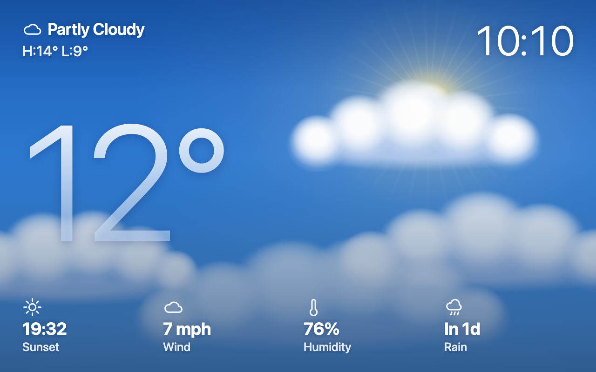 | 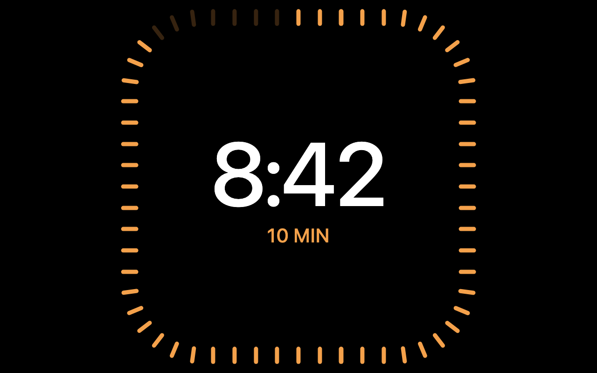 | 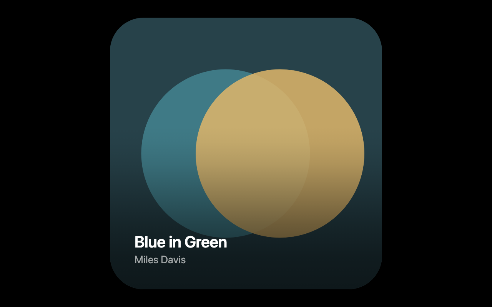 |

| Photo frame | Month calendar | Weather widget (tile) |
| --- | --- | --- |
| 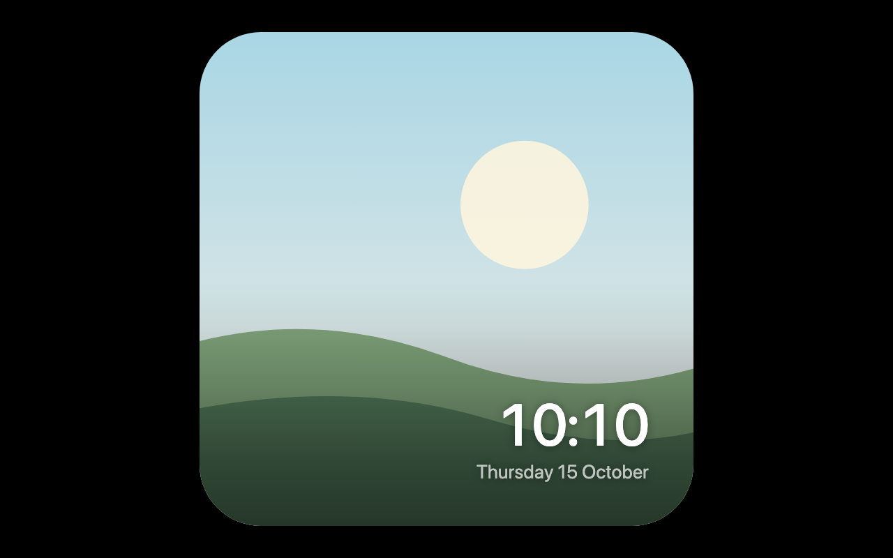 | 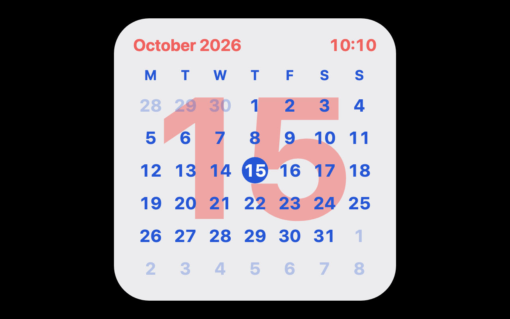 | 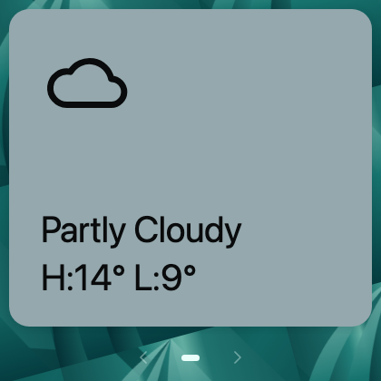 |

The [home summary](docs/overviews/home.md) brings your home together: a quick look at lights and heating, cameras, scenes
and anything that needs attention. It works in landscape and portrait:

| Home summary (1280 x 800) | Home summary (800 x 1280) |
| --- | --- |
|  | 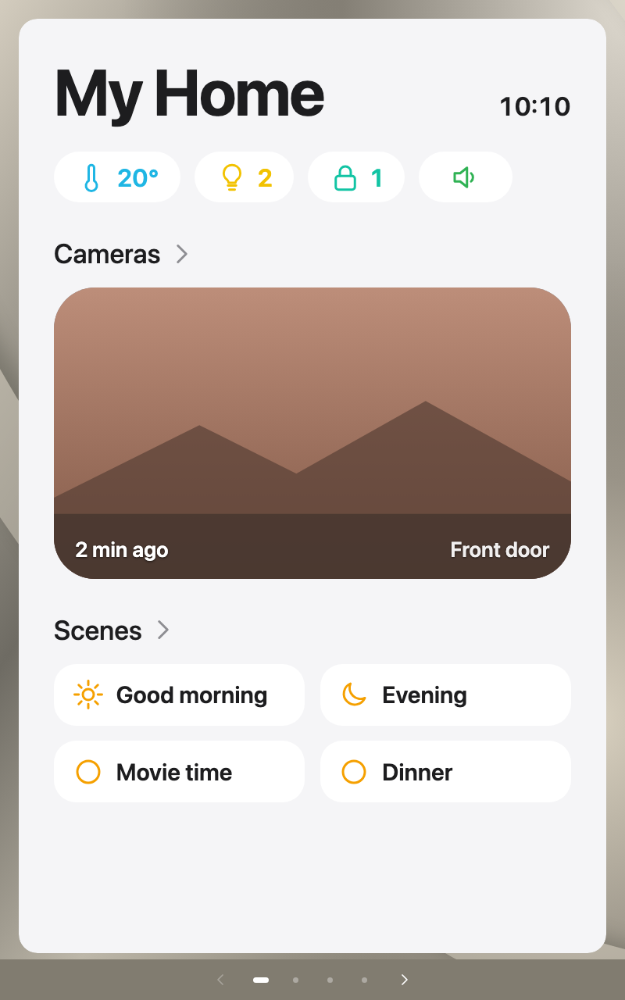 |

## Features

* **A few pages, easy to find your way around.** Swipe between screens, tap the page dots or use the arrow keys.
  Each page fits the display in landscape or portrait.
* **Everyday controls.** Lights, heating, blinds, locks, fans, switches, cameras, music, timers, weather and more.
  Use them together or add individual HouseView cards to an existing dashboard.
* **Space to adjust things comfortably.** Open a light to drag its brightness up or down, set the heating on a full-screen
  thermostat, or browse your music favourites with artwork and swipeable pages.
* **A useful home summary.** See the state of your home, run scenes, and check open doors, low batteries, lights left on
  and devices that need attention. Open it from the home button, or swipe down from the top of the display. Battery
  warnings can find the relevant Home Assistant entities automatically.
* **Useful while idle.** Choose weather, photos, a calendar or another full-screen view. Timers and playing music can
  bring up their own displays automatically.
* **A consistent look.** Choose glass, soft, teal, silver, champagne, sage, slate, dusk or blush, with light and dark appearances, high contrast
  and a bedtime mode with a Dim button.
* **Made for wall tablets and square panels.** Large touch targets, a camera grid and an optional tablet mode that hides
  Home Assistant's sidebar and header. A lighter appearance helps older tablets and an NSPanel Pro keep up. On a
  480 × 480 panel, four controls fill a page.
* **Set it up your way.** Use Home Assistant's visual editor or YAML, with support for scenes, scripts and custom actions.

## Terminology

| Term | Meaning |
| --- | --- |
| **Widget** | Any element on a page: clock, date, calendar, light, switch, fan, lock, blinds, thermostat, sensor, weather, music player, camera, timer, alarm panel, action |
| **Overview** | A full-screen view. It can be a screensaver, appear automatically (the running-timer display, the album cover while music plays), open when you press a widget (the month calendar from a date or calendar widget; the weather scene; the photo frame), or be used as a card |
| **Page** | One swipeable screen of widgets |
| **Carousel** | The `custom:houseview-card` card that holds the pages |

In configuration the literal names are used: `type: custom:houseview-<kind>-card`, `custom:houseview-widget-card` with
`widget_type`, the `cards:` key (`widgets:` is accepted as an alias), `pages` and `screensaver`.

## Requirements

* Home Assistant **2024.8.0** or newer (`hacs.json`).
* A frontend browser based on **Chrome 105** or later. That includes current desktop browsers, the Home Assistant companion
  app and the Android WebView on wall tablets.
* For a wall tablet: a device that keeps its screen on, a panel view dashboard, and ideally a kiosk browser or the companion
  app. HouseView was tuned for 1280 x 800 landscape and 800 x 1280 portrait; it adapts to phones and larger screens. See
  [tablet mode](docs/tablet.md) and [performance](docs/performance.md).
* For an NSPanel Pro 86: the panel's 480 × 480 screen and a browser based on Chrome 105 or newer. See
  [NSPanel Pro](docs/nspanel.md).

## Installation

### With HACS

1. In HACS open the menu, choose **Custom repositories**, add `https://github.com/dandoingdev/HouseView` with category
   **Dashboard**.
2. Search for **HouseView** in HACS and press **Download**.
3. Check that **Settings > Dashboards > Resources** has `/hacsfiles/<repository name>/houseview.js` as a **JavaScript module** (HACS
   normally adds it), then hard-refresh your browser.

### Manually

1. Download `houseview.js` from the [latest release](https://github.com/dandoingdev/HouseView/releases/latest) and copy it to
   `/config/www/houseview/houseview.js`.
2. Under **Settings > Dashboards > Resources** (enable *Advanced mode* in your user profile to see it) add the resource
   `/local/houseview/houseview.js` as a **JavaScript module**.
3. Hard-refresh your browser.

**Caching.** Browsers and wall tablets keep the old file. After an update append a version to the resource URL
(`/local/houseview/houseview.js?v=1.7.0`), hard-refresh, and reset the frontend cache in the companion app or kiosk browser.

**Kiosk mode.** Add `?tablet=1` to the dashboard address (or set `tablet_mode: true`) and HouseView hides Home Assistant's
sidebar and header so the carousel uses the whole screen. This relies on Home Assistant internals that are not a public API,
so it can stop working after a Home Assistant update; see [tablet mode](docs/tablet.md) for kiosk alternatives.

Details and troubleshooting: [Installation](docs/installation.md).

## Quick start

Create a dashboard view of type **Panel (1 card)**, open the raw configuration editor and use a carousel with two pages and a
screensaver:

```yaml
title: Home
views:
  - title: Home
    path: home
    type: panel
    cards:
      - type: custom:houseview-card
        pages:
          - {name: Kitchen, surface: teal}
          - {name: Home, surface: glass}
        cards:
          - {type: custom:houseview-clock-card, page: Kitchen}
          - {type: custom:houseview-date-card, page: Kitchen}
          - {type: custom:houseview-camera-card, entity: camera.front_door, page: Kitchen}
          - {type: custom:houseview-timer-card, entity: timer.kitchen_timer, page: Kitchen}
          - {type: custom:houseview-light-card, entity: light.living_room, page: Home}
          - {type: custom:houseview-light-card, entity: light.hallway, page: Home}
          - {type: custom:houseview-climate-card, entity: climate.living_room, page: Home}
          - {type: custom:houseview-lock-card, entity: lock.front_door, page: Home}
        screensaver:
          type: weather
          entity: weather.home
          idle_timeout: 120 # seconds without a touch; the first tap only wakes it
```

Replace the entity ids with your own. The card has a visual editor (**Edit dashboard**, then **Edit** on the card). More
dashboards are in [`examples/`](examples/): [minimal](examples/minimal.yaml), [kitchen tablet](examples/kitchen.yaml),
[tablet kiosk](examples/tablet-kiosk.yaml), [NSPanel Pro](examples/nspanel.yaml), [bedtime](examples/bedtime.yaml), [single cards](examples/single-cards.yaml),
[camera grid](examples/camera-gallery.yaml), [native cards](examples/native-cards.yaml),
[weather screensavers](examples/screensaver-weather.yaml), [weather overview](examples/weather-overview-card.yaml),
[photo frame](examples/photo-frame.yaml), [month calendar](examples/month-calendar.yaml),
[timer and music displays](examples/timer-and-music.yaml), [home summary](examples/home-overview.yaml) and the [`widgets:` alias](examples/widgets-key.yaml).

## Widgets

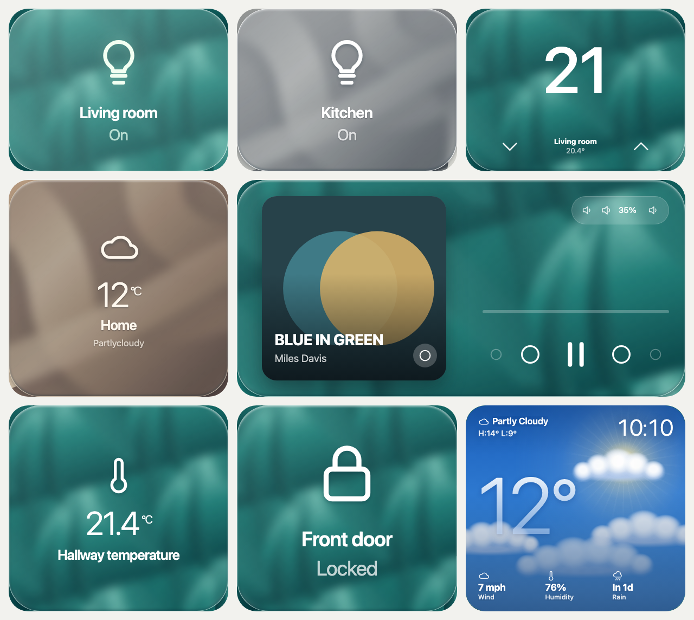

In the carousel write `type: custom:houseview-<type>-card`. On a dashboard of its own the same string is a card; it appears
in the picker as **HouseView · Light** and so on. Every widget accepts `size` (`normal`, `wide`, `tall`, `large`), `name` and
`page`; widgets whose whole face is one button also accept [`tap_action`, `hold_action` and
`double_tap_action`](docs/actions.md).

| Widget | `type` | Entity | Key options | A tap |
| --- | --- | --- | --- | --- |
| [Clock](docs/widgets/clock.md) | `clock` | none | `name` | Opens World Clock |
| [Date](docs/widgets/date.md) | `date` | none | | Opens the month calendar |
| [Calendar](docs/widgets/calendar.md) | `calendar` | `calendar.*` | | Opens the month calendar (or the entity dialog with `calendar_view: false`) |
| [Camera](docs/widgets/camera.md) | `camera` | `camera.*` | card option `camera_gallery` | Opens the camera grid, or the entity dialog |
| [Thermostat](docs/widgets/climate.md) | `climate` | `climate.*` | `room` | Chevrons set the target temperature; the number opens the thermostat view (or the dialog with `climate_view: false`) |
| [Light](docs/widgets/light.md) | `light` | `light.*` | `action` (`view`, `toggle`, `off`), `icon` | Hold opens brightness; tap toggles, or turns off |
| [Switch](docs/widgets/switch.md) | `switch` | `switch.*` | `icon` | Toggles |
| [Fan](docs/widgets/fan.md) | `fan` | `fan.*` | `icon` | Toggles |
| [Blinds](docs/widgets/cover.md) | `cover` | `cover.*` | | Keys open, stop and close |
| [Lock](docs/widgets/lock.md) | `lock` | `lock.*` | `icon` | Locks or unlocks (asks before unlocking) |
| [Sensor](docs/widgets/sensor.md) | `sensor` | `sensor.*` | `icon` | Opens the entity dialog |
| [Weather](docs/widgets/weather.md) | `weather` | `weather.*` | | Opens the entity dialog |
| [Music](docs/widgets/media_player.md) | `media_player` | `media_player.*` | | Transport, volume, shuffle and repeat keys; a small tile opens the full player; the dots open the dialog |
| [Timer](docs/widgets/timer.md) | `timer` | `timer.*` | | Presets start the timer; pause, resume, cancel |
| [Alarm panel](docs/widgets/alarm_control_panel.md) | `alarm_control_panel` | `alarm_control_panel.*` | | Opens the alarm view to arm and disarm (or the dialog on hold with `alarm_view: false`). Works with any alarm entity, e.g. [Alarmo](#works-with-alarmo) |
| [Vacuum](docs/widgets/vacuum.md) | `vacuum` | `vacuum.*` | `icon` | Opens the cleaning panel (or the dialog on hold with `vacuum_view: false`) |
| [Action](docs/widgets/action.md) | `action` | `scene.*`, `script.*`, `button.*`, `input_button.*` | `icon`, `note` | Runs the scene, script or button |

## Overviews

An overview is a full-screen view. See [overviews and screensavers](docs/screensavers.md) for how they start, what blocks
them and how to combine them.

| Overview | `type` | Activation | Entity | Options | Card type |
| --- | --- | --- | --- | --- | --- |
| [Weather overview](docs/overviews/weather.md) | `weather` | Idle screensaver; opened by pressing its small widget (`display: tile`) | `weather.*` | `sun_entity`, `details`, `show_time`, `show_unit`, `frosted`, `daylight` | `custom:houseview-weather-overview-card` |
| [Timer display](docs/overviews/timer.md) | `timer` | Event: while a timer runs (automatic) | `timer.*` | none | `custom:houseview-timer-overview-card` |
| [Cover art](docs/overviews/cover_art.md) | `cover_art` | Idle, wins over weather while a speaker plays (automatic) | `media_player.*` | none | `custom:houseview-cover-art-overview-card` |
| [Photo frame](docs/overviews/photo_frame.md) | `photo_frame` | Idle screensaver; opened by pressing the card | none | `folder`, `interval`, `shuffle`, `recursive`, `show_time` | `custom:houseview-photo-frame-overview-card` |
| [Volume view](docs/overviews/volume.md) | `volume` | Opened by the music volume button | `media_player.*` | none | `custom:houseview-volume-overview-card` |
| [Clock](docs/overviews/clock.md) | `clock` | Analogue or digital idle screensaver; opened by pressing the card | none | `face`, `use_dashboard_background`, `background_color`, `second_color`, `show_seconds`, `show_date` | `custom:houseview-clock-overview-card` |
| [World Clock](docs/overviews/world_clock.md) | `world_clock` | Opened by pressing the clock widget | none | `entities`, `show_local` | `custom:houseview-world-clock-overview-card` |
| [Month calendar](docs/overviews/calendar_month.md) | `calendar_month` | Opened by pressing a date or calendar widget; idle screensaver in YAML only | none | `week_start`, `show_time` | `custom:houseview-calendar-month-overview-card` |
| [Home summary](docs/overviews/home.md) | `home` | A page of the dashboard, the home button, a swipe down from the top, or an idle screensaver | none (built from the carousel's widgets) | `title`, `show_time` | `custom:houseview-home-overview-card` |
| [Light view](docs/overviews/light.md) | `light` | Control panel opened by holding a light widget | `light.*` | `icon` | `custom:houseview-light-overview-card` |
| [Thermostat view](docs/overviews/climate.md) | `climate` | Control panel opened by pressing the thermostat widget's number; not a screensaver choice | `climate.*` | `show_time` | `custom:houseview-climate-overview-card` |
| [Vacuum view](docs/overviews/vacuum.md) | `vacuum` | Control panel opened by tapping a vacuum widget; not a screensaver choice | `vacuum.*` | none | `custom:houseview-vacuum-overview-card` |
| [Alarm view](docs/overviews/alarm_control_panel.md) | `alarm_control_panel` | Control panel opened by tapping an alarm panel widget; not a screensaver choice | `alarm_control_panel.*` | none | `custom:houseview-alarm-control-panel-overview-card` |

```yaml
type: custom:houseview-card
cards:
  - type: custom:houseview-clock-card
screensaver:                      # one overview, or a list that takes turns
  - {type: weather, entity: weather.home, idle_timeout: 120}
  - {type: photo_frame, folder: media-source://media_source/local/Photos, idle_timeout: 120}
```

### Automatic displays

Two overviews need no `screensaver` entry. They follow the widgets on the carousel:

| Card option | Default | Behaviour |
| --- | --- | --- |
| `timer_display` | `true` | Every `timer` widget shows the timer display while its timer runs. A tap puts the dashboard back; it returns for the next timer |
| `music_screensaver` | `true` | When the screensaver would start and a speaker is playing, the album cover is shown instead of the usual screensaver |
| `world_clock_view` | `true` | `false` disables the clock widget’s World Clock overlay |
| `calendar_view` | `true` | `false` stops the date and calendar widgets from opening the month calendar |
| `weather_view` | `true` | `false` makes the weather widget open more-info instead of the full-screen weather |
| `climate_view` | `true` | `false` makes the thermostat widget open more-info instead of the full-screen thermostat view |
| `vacuum_view` | `true` | `false` makes the vacuum widget open more-info on hold instead of the full-screen cleaning panel |
| `alarm_view` | `true` | `false` makes the alarm panel widget open more-info on hold instead of the full-screen alarm view |

Each can be `false`; `timer_display` and `music_screensaver` also take a list of entities. Passive overviews only read data. Light and thermostat control panels route explicit button and slider input through the same guarded actions as their widgets.

## Works with Alarmo

The alarm panel widget shows any `alarm_control_panel` entity. Tapping it opens the alarm view, where you arm Home, Away, Night or Holiday and disarm (disarming asks to confirm). A panel that wants a code is finished in Home Assistant's own dialog: hold the tile, or use the Code key in the view.
It pairs naturally with **[Alarmo](https://github.com/nielsfaber/alarmo)**, a community alarm system for Home Assistant. Alarmo is a
separate project that you install and configure yourself; HouseView does not bundle it, and arms or disarms only when you press a key.

1. Install Alarmo through HACS (category Integration) and restart Home Assistant.
2. Add the **Alarmo** integration under **Settings > Devices & services**, then use the **Alarmo** sidebar panel to set up areas,
   sensors, modes and the users and codes that may arm and disarm.
3. Find the entity Alarmo created (by default `alarm_control_panel.alarmo`) under **Settings > Devices & services > Entities**.
4. Add it to a page:

```yaml
- {type: custom:houseview-alarm_control_panel-card, entity: alarm_control_panel.alarmo, name: Alarm, page: Home}
```

More detail is in the [alarm panel widget page](docs/widgets/alarm_control_panel.md).

## Looks and performance

| Option | Values |
| --- | --- |
| `surface` (per page) | `glass`, `soft`, `teal`, `silver`, `champagne`, `sage`, `slate`, `dusk`, `blush` |
| `wallpaper` | `teal`, `silver`, `champagne`, `sage`, `slate`, `dusk`, `blush`: one background behind every page |
| `appearance` | `auto` (follows Home Assistant), `light`, `dark` |
| `palette` | `stone`, `forest` |
| `high_contrast`, `bedtime` | `true` / `false`; bedtime adds night styling and a Dim button |
| `performance` | `auto`, `full`, `lite`: `lite` uses opaque glass and no decorative animation. `auto` picks it on a device with 2 GB of memory or less, 4 cores or fewer, or an old Android WebView |
| `home_overview` | `true` adds a scrollable home screen (chips, cameras, scenes) built from your widgets. The home button opens it, and so does a downward swipe from the top of the display; `home_title` sets its title |
| `editor_preview` | `landscape` (default), `portrait` or `auto`: how the preview in the card editor is drawn. The card is laid out as a wall tablet and scaled to fit the preview, so it shows the real arrangement |

See [theming](docs/theming.md) and [performance](docs/performance.md).

## Editor

Every card has a visual editor that uses Home Assistant's own forms: the carousel editor has Appearance, one section per page
(with Home Assistant's card editor for the widgets on it), Screensaver, Automatic displays and Camera grid sections; widget
cards have a settings form with entity selectors. The preview follows the page or full-screen view you are editing. YAML always works, and options the forms do not show (such as a list of
screensavers, `confirm_mode` or `tap_action`) are kept when you edit.

## Configuration reference

Card-level options of `custom:houseview-card` (details and defaults in [Configuration](docs/configuration.md)):

| Option | What it does |
| --- | --- |
| `cards` (alias `widgets`) | The widgets, in order |
| `pages` | `name`, `surface` and `columns` (landscape, 2 to 5) per page |
| `appearance`, `palette`, `wallpaper`, `high_contrast`, `bedtime` | Look |
| `performance` | `auto`, `full`, `lite` |
| `camera_gallery` | A grid of one to four cameras |
| `screensaver` | An overview or a list of them: `type`, `entity`, `idle_timeout`, `enabled`, `preview`, `start_in_edit_mode`, plus the overview's own options |
| `timer_display`, `music_screensaver`, `calendar_view`, `weather_view`, `climate_view`, `vacuum_view`, `alarm_view`, `world_clock_view` | The automatic displays |
| `confirm_mode` | `native` (browser dialog) or `inline` (a sheet inside the card) |
| `localized_states` | Show entity states in your Home Assistant language |
| `state_compare` | `auto`, `reference` or `deep`: how state changes are detected (leave at `auto`) |
| `tablet_mode` | The same as `?tablet=1`. Also the **Tablet mode** switch in the card editor |
| `show_header` | Show the date on the left and time centred above every page |
| `home_overview`, `home_title` | Show the home summary (button and a swipe down from the top) and choose its title |
| `home_attention` | Choose the doors, lights and devices to watch for attention |
| `home_battery_auto` | Find low batteries automatically; see [Home summary](docs/overviews/home.md) |

## Translations

All interface text is English today (widgets, the editor, error messages). Dates, times and numbers follow your Home Assistant
language and time zone; entity states can be shown in your language with `localized_states: true`; the weather overview also
ships German text. Contributions to help HouseView feel at home in more languages are welcome; see
[CONTRIBUTING.md](CONTRIBUTING.md).

## Troubleshooting and FAQ

| Question | Answer |
| --- | --- |
| "Custom element doesn't exist: houseview-card" | The resource is missing or not a JavaScript module. See [Installation](docs/installation.md#troubleshooting) |
| The card looks old after an update | Change the `?v=` of the resource URL, hard-refresh, reset the app or kiosk cache |
| The carousel does not fill the screen | Use a **panel view**. Single widget cards work in any view |
| `?tablet=1` does nothing | It depends on Home Assistant internals; use a kiosk browser. See [tablet mode](docs/tablet.md) |
| The screensaver never starts | `idle_timeout: 0`, `enabled: false`, the camera grid is open, a service call is running, or the dashboard is in edit mode. See [overviews and screensavers](docs/screensavers.md#troubleshooting) |
| The album cover does not appear | The speaker must be playing with a picture served by your Home Assistant, and the screensaver timeout must not be `0` |
| The wall tablet is slow | Set `performance: lite`. See [performance](docs/performance.md) |
| Can HouseView change my devices on its own? | No. A service is called only when you press a control or configure a `tap_action` that does |

## Development

```sh
git clone https://github.com/dandoingdev/HouseView.git
cd houseview
npm install
npm run build:dev    # dist/houseview.js, unminified
npm run dev          # watch build plus a local server on http://127.0.0.1:8765
```

Needs Node 24 or newer and Google Chrome for the browser tests. Useful commands:

| Command | What it does |
| --- | --- |
| `npm run build` | The production bundle `dist/houseview.js` |
| `npm run gen` | Regenerates the widget and overview index files after adding a folder |
| `npm run gen-docs` | Regenerates `docs/widgets` and `docs/overviews` from the READMEs next to the code |
| `npm run lint`, `npm run format:check` | ESLint and Prettier |
| `npm run check:widgets`, `npm run check:overviews` | The widget and overview contract linters |
| `npm test` | Unit, browser, widget and overview suites (browser suites in parallel) |
| `npm run test:release` | `npm test` plus the minified bundle |
| `npm run new:widget`, `npm run new:overview` | Scaffold a new widget or overview |

To add a widget or an overview read [CONTRIBUTING.md](CONTRIBUTING.md), the [widget API](docs/widget-api.md) and the
[overview API](docs/overview-api.md); the [architecture](docs/architecture.md) explains the structure.

## Documentation

| | |
| --- | --- |
| [Installation](docs/installation.md) | HACS, manual, caching, kiosk, troubleshooting |
| [Configuration](docs/configuration.md) | Every option of the carousel, pages and widgets |
| [Widgets](docs/widgets/index.md) | One page per widget |
| [Overviews and screensavers](docs/screensavers.md) | Overviews, screensavers, automatic displays |
| [Actions](docs/actions.md) | What each widget does, `tap_action`, `hold_action`, `double_tap_action` |
| [Theming](docs/theming.md) | Surfaces, palettes, appearance, the Home Assistant theme |
| [Tablet mode](docs/tablet.md) | Wall displays, `?tablet=1`, kiosk setups |
| [NSPanel Pro](docs/nspanel.md) | 480 × 480 wall panels, four controls a page |
| [Cameras](docs/cameras.md) | The snapshot widget and the camera grid |
| [Performance](docs/performance.md) | `performance`, weak tablets, measuring |
| [Architecture](docs/architecture.md), [Widget API](docs/widget-api.md), [Overview API](docs/overview-api.md) | For contributors |
| [Changelog](CHANGELOG.md) | What changed in each release |

## Contributing

Bug reports and ideas are welcome in the issue tracker; the templates ask for the HouseView and Home Assistant versions and the
card YAML with entity ids anonymised. To change code or add a widget, read [CONTRIBUTING.md](CONTRIBUTING.md). Everyone taking
part is expected to follow the [code of conduct](CODE_OF_CONDUCT.md).

## Support the project

HouseView is free and MIT licensed, built and maintained in spare time. If it is useful to you, these are the ways to help
keep it going:

* **Star the repository and tell other people** who run Home Assistant on a wall tablet.
* **Report bugs and share your setup** in the [issues](https://github.com/dandoingdev/HouseView/issues). Feedback from different
  devices is the most valuable contribution.
* **[Buy me a coffee](https://buymeacoffee.com/dandoingdev)** to support further development.
* **Take a look at [AmongFolk.com](https://amongfolk.com)**, my main venture, which is where most of my time goes.

## Security and privacy

* HouseView loads no external scripts or fonts. Playlist artwork loads the thumbnail URLs supplied by your configured music services, without a page referrer or added Home Assistant authentication.
* Camera snapshots, now-playing album art and photo-frame images stay on Home Assistant’s own address and approved proxy paths. Playlist-browser thumbnails use the original media-browser image URLs as described above.
* Passive overviews are read-only. Interactive views route controls through the widget action dispatcher; service calls
  require explicit control input or a configured action. Entity names and states are escaped before they reach the page.
* The `url` action only opens `http`, `https`, `mailto` and `tel` links.
* Files in `/config/www` are public; put only `houseview.js` there.

To report a vulnerability see [SECURITY.md](SECURITY.md).

## License

[MIT](LICENSE).

## Disclaimer

HouseView is an independent community project. It is **not affiliated with, endorsed by or sponsored by Apple Inc., Home
Assistant, Nabu Casa or Shenzhen Sonoff Technologies Co., Ltd.** "Home Assistant" and "NSPanel Pro" are trademarks of
their owners. The panel frames in this README are a mock of that panel's proportions. HouseView's visual style is
original; it uses no third-party fonts or images. Most icons come from the Material Design Icons set that Home Assistant itself provides, which
HouseView does not bundle; a few glyphs and the wallpapers are drawn by HouseView.

## Acknowledgements

Thanks to the [Home Assistant](https://www.home-assistant.io/) project for the frontend, the card and editor conventions and
the Material Design Icons it provides, to the [HACS](https://hacs.xyz/) maintainers, and to the authors of the development
tools: [esbuild](https://esbuild.github.io/), [ESLint](https://eslint.org/), [Prettier](https://prettier.io/) and
[Puppeteer](https://pptr.dev/). The code of conduct is the [Contributor
Covenant](https://www.contributor-covenant.org/), version 2.1.
