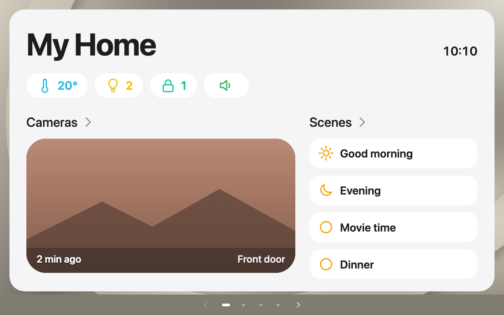

<!-- Generated by tools/gen-docs.mjs from src/overviews/home/README.md. Do not edit this file. -->

# Home summary

> Overview type `home` (since 1.1). Entity: none. Card type `custom:houseview-home-overview-card` (widget type `home_overview`), screensaver `type: home`.

A scrollable home screen that **builds itself from the widgets on the carousel**. Put it on a page of its own
(`custom:houseview-home-overview-card`) and it shows a large title with the time, a row of chips, the cameras and the
scenes of the dashboard. Nothing is configured: add or remove a light, a lock or a camera widget and the screen follows.
Everything reads from the card's widget list and Home Assistant; the overview never calls a service itself.



## What is shown

| Part | Built from | A press |
| --- | --- | --- |
| **Climate chip** (cyan) | `climate` widgets: the current temperatures as a range (`20-22°`, `21°` when there is one value or all agree, `--` when none is known) | Goes to the page of the first climate widget |
| **Lights chip** (yellow bulb) | `light` widgets: how many are on (dim at 0) | Goes to the page of the first light widget |
| **Locks chip** (teal lock) | `lock` widgets: how many are locked. When any lock is unlocked, open or jammed the chip turns amber with an open lock and counts those instead | Goes to the page of the first lock widget |
| **Media chip** (speaker) | `media_player` widgets; a subtle green accent while one is playing | Goes to the page of the first media player widget |
| **Cameras** | Up to three `camera` widgets: a large rounded snapshot with a small "2m ago" label (from the entity's `last_updated`, in your language) | Opens the camera gallery when the card has `camera_gallery`, otherwise the camera's more-info dialog. The heading "Cameras" goes to the page of the first camera widget |
| **Scenes** | Every `action` widget whose entity is a `scene.*` (scripts and buttons are not listed): a tile with the icon and name, two per row | Runs the scene. The heading goes to the page of the first scene widget |

### House needs attention (optional)

Enable **Find low batteries automatically** in **Edit card → Home summary**, or set `home_battery_auto: true` on the
parent card. Discovery matches Home Assistant Maintenance: visible `sensor` and `binary_sensor` entities with
`device_class: battery`, including devices without an area. Percentage readings at or below 20% and binary low-battery
sensors reporting On appear in attention. A related `battery_charging` sensor on the same device suppresses percentage
warnings while On. Unknown/unavailable readings are not low-battery readings. New devices, visibility changes and
charging state changes are reflected automatically; no battery entity list is needed. Phones and other personal devices
are included when their battery entities are visible, just as in Maintenance.

Choose a list under **Edit card → Home summary → House needs attention**, or supply `home_attention` on the parent card.
This list controls the other checks; automatic battery discovery is enabled separately.

```yaml
home_attention:
  - entity: binary_sensor.study_window
    kind: opening
    name: Study window
  - entity: sensor.bedside_button_battery
    kind: battery
    below: 20
  - entity: light.hall
    kind: light
    after: 120
  - entity: climate.bedroom
    kind: device
    after: 5
```

`opening` shows contacts reporting On (open). `battery` shows numeric percentages at or below `below` (20 by default),
including zero, or a binary low-battery sensor reporting On. `light` shows a light continuously On for `after` minutes
(120 by default), using its real `last_changed` timestamp. This is a duration check, not an occupancy judgement.
`device` shows Unavailable or Unknown after `after` minutes (5 by default). Unknown/unavailable monitored contacts,
batteries and lights also appear after five minutes; missing entities appear as Not reporting. Invalid battery readings
never become zero; unknown contacts never count as closed. Changes update immediately, and duration thresholds are
rechecked each minute even when the clock is hidden.

Rows reuse Home's rounded surfaces and amber accents. A press opens the entity's normal details and never sends a device
service. The same section appears in embedded and full-screen Home, with the existing close button retained. With no
issues it says “No issues detected in monitored devices”; with no configured checks the section is absent.

### Bins and transport chips (optional)

Two optional chips are read from the **card** configuration (the same keys work wherever the overview is shown). The card editor's **Home summary** section edits them, with the switch and the title:

```yaml
home_bins: sensor.bins          # a waste_collection_schedule sensor with details_format: upcoming
home_transport:                 # as many as you like
  - entity: sensor.london_tfl_piccadilly_940gzzlutpn_all
    label: Work                 # shown on the chip (default: the sensor's name)
    icon: mdi:subway-variant    # any icon (default: mdi:subway-variant)
```

* **Bins**: one chip of icons, one per bin type going out in the next 7 days (recycling, general waste, food, garden, glass,
  paper). It turns amber when a bin goes out today or tomorrow and is absent when none is due. A press opens the sensor.
* **Transport**: one chip per entry with the label and the next departure time (the London TfL sensor's `HH:MM` state). When the
  sensor has no departure (`None`, unavailable) the chip turns amber and says "Not running". A press opens the sensor.

A chip, a section or a camera exists only when the carousel has widgets of that kind. With none of them the screen says
"Add lights, climate, locks, cameras or scenes to this dashboard". Snapshots are loaded from your own Home Assistant
only (`/camera_proxy/`), refreshed every 30 seconds on the shared ticker; the "2m ago" label and the clock change on the
minute. Nothing blurs, filters or animates, so it is cheap on a weak tablet. The panel is light and turns dark with the
carousel's dark appearance.

| Option | Type | Default | Description |
| --- | --- | --- | --- |
| title | text | Home | The large heading |
| show_time | boolean | true | Show the time at the top right (in your time format) |

The card takes `page`, `size` (default `large`) and `name`; it takes no entity. It can be a page of the dashboard (the
chips, cameras and scenes are buttons) or a **screensaver**: choose **Home summary** in the editor's screensaver list
(or `screensaver: {type: home}`) and the same screen appears after the idle time, instead of, say, the weather. As a
full-screen view it remains interactive: scene tiles run their scenes, and the close button or Escape returns to the
dashboard. With `home_overview: true` on the carousel, the home button opens this screen, and a downward swipe from the
top of the display does the same. On a short panel that top band is taller, which is the easier reach when the button
sits in the navigation. The screensaver shows the carousel's lights, climate, locks, cameras and scenes, so it follows
what you add. A page that holds only this overview also takes the overview's colour for the whole page background, and
the page dots change colour to match.

```yaml
type: custom:houseview-card
pages:
  - {name: Home, surface: glass}
  - {name: Rooms, surface: teal}
cards:
  - {type: custom:houseview-home-overview-card, page: Home, title: My Home}
  - {type: custom:houseview-light-card, entity: light.kitchen, page: Rooms}
  - {type: custom:houseview-camera-card, entity: camera.front_door, page: Rooms}
  - {type: custom:houseview-action-card, entity: scene.evening, page: Rooms}
camera_gallery:
  - {entity: camera.front_door}
```

